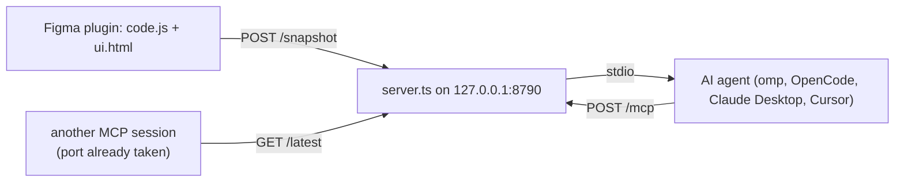

# Figma Inspector

Figma plugin + MCP server. The plugin dumps the selected node and its entire subtree — every readable property, recursively — as JSON, plus a semantic text summary you can paste into an AI coding agent. The optional MCP server receives those dumps over localhost and exposes them to any MCP client as tools and resources.



The plugin works standalone — the MCP server is only needed for the agent workflow.

## Features

- **Full recursive dump** of the selection (parent → children, including invisible children of instances), capped at `MAX_NODES` (2000) per snapshot. Past the cap the root gets `truncated: true` and the cut node gets `childrenTruncated: true`, so the payload still renders. Raise `MAX_NODES` in `code.js` for bigger dumps.
- **Every node property**, not a curated subset: `NODE_FIELDS` in `code.js` holds all **183** non-node properties from `@figma/plugin-typings` and is applied to every node type — so `boundVariables`, `explicitVariableModes`, `layoutGrids`, `gridStyleId`, `componentProperties`, `componentPropertyDefinitions`, `reactions`, `annotations`, `devStatus`, `overrides`, `absoluteTransform`, `relativeTransform`, `absoluteRenderBounds`, `vectorNetwork`, `exportSettings`, `min/maxWidth|Height` and the rest come along.
- **Enrichment that needs its own lookup:**
  - `textSegments` — per-range styles for TEXT via `getStyledTextSegments`; mixed values are marked `"figma.mixed"` instead of disappearing.
  - `textLayer` — text sublayer contents for `SHAPE_WITH_TEXT`, `TABLE_CELL`, `TEXT_PATH`.
  - `pluginData` — plugin data stored on the node.
  - `mainComponentId` for instances.
- **Reference maps** in the snapshot root, deduped to one lookup per id: `styles` (name + type), `variables` (name, type, `valuesByMode`, `codeSyntax`), `variableCollections` (with `modes`), `components` (name + key).
- **Browse + select** from inside the plugin: list pages, then walk the node tree lazily; clicking a row selects that node on the canvas and dumps it immediately. There is also *Select by ID* for pasting a node id (`1:23`).
- **Four tabs** — **JSON** (raw, complete), **Tree** (hierarchy summary), **AI Prompt** (semantic description: hex RGBA, flex/padding/gap, fonts, text, segment count, sibling spacing), **Browse**. Inactive data views are built only when their tab is opened, so a large payload no longer builds three views at once.
- Auto-refresh on selection change (toggleable), Copy and Download for the active view, JSON size in the meta bar, and a live MCP push status.

### Deliberately not dumped

- **Node-valued properties** (`parent`, `mainComponent`, `stuckNodes`, `attachedConnectors`, `selection`, …) — they serialize to `{}` or recurse forever. The ones we need are read explicitly: `children`, the `text` sublayer, `mainComponent.id`.
- **`fillGeometry` / `strokeGeometry` / `vectorPaths`** — tens of MB for complex vectors. `vectorNetwork` (vertices + segments) is included and is enough to rebuild the path; re-add these if you need flattened paths.
- **Image/video bytes** — only `imageHash` / `videoHash` are stored, never the data.

## Install the plugin (Figma Desktop)

The plugin is `manifest.json` + `code.js` + `ui.html` — plain JS on purpose, since Figma loads both files directly (no bundler step).

> The npm package `figma-inspector-mcp` is **not published yet** (registry returns 404 as of 2026-10-15), so `npx` installs are not available. Use the repo folder. Once published, `npm install figma-inspector-mcp` in an empty folder and point Figma at `node_modules/figma-inspector-mcp`.

1. Clone/copy this folder (nothing to build).
2. Figma → **Plugins** → **Development** → **New plugin…**
3. **Link existing plugin** → pick this folder's `manifest.json`
4. Run **Figma Inspector** from Plugins → Development

## Using the plugin

1. Select a node on the canvas (selecting a parent pulls in its whole subtree) — or open the **Browse** tab, hit **Pages**, and click the node you want (the tree loads lazily, so large files stay responsive).
2. The plugin shows the full JSON; use **Copy** or **Download .json**.
3. **Select by ID**: Browse tab → type the node id (visible in the JSON or in Figma's panel) → **Select**. The plugin switches to the node's page, selects it, scrolls/zooms it into view, and dumps it.

Views: **JSON**, **Tree**, **AI Prompt**, **Browse**. Copy/Download export the active view (`figma-inspector-json.json`, `figma-inspector-tree.txt`, `figma-inspector-ai-prompt.txt`).

### AI Prompt format

```
Figma design file: "Demo File"
Page: "Page 1"
Selected 1 node(s), 3 node(s) in subtree.
Reproduce this layout as code: every node is listed parent→child, with spacing between siblings.

[FRAME] Card (320×140) @ (0,0)
  · flex column · padding 16 all · align left/top (main) · center (cross) · sizing fixed(w)/hug(h) · clips-overflow · radius 8 · fill #1a1a1f
  [TEXT] Title (288×24) @ (16,16)
    · fill #ffffff
    → text: "Hello / world" · font: Inter / Bold 18px · color: #ffffff · align-text: left
  [TEXT] Body (288×20) @ (16,48)
    · fill #cccccc
    → text: "Second line" · font: Inter / Regular 14px · color: #cccccc
  → children gap 8
```

Per node: `[TYPE] name (w×h) @ (x,y)`, then a `·`-joined property line (flex direction, padding, alignment, hug/fill/fixed sizing, clipping, wrap, radius, fill hex, stroke, opacity, effect types, grid count), then text info (content, font, color, alignment, mixed styles), sublayer text, component props, main component, and the measured gap between siblings (a single value when even, `gaps min–max` when not). Colors are `#rrggbb`, with alpha appended when below 1. Mixed values are shown as `figma.mixed`.

If the dump is truncated the header says so and asks you to narrow the selection.

## Snapshot JSON shape

```jsonc
{
  "exportedAt": "2026-10-15T04:12:33.001Z",
  "file": { "key": "abc123", "name": "Demo File" },
  "page": { "id": "0:1", "name": "Page 1" },
  "selectionCount": 1,
  "totalNodeCount": 42,
  "maxNodes": 2000,
  "truncated": false,
  "referenceCounts": { "styles": 2, "variables": 5, "components": 1 },
  "selection": [ /* nodes: every property from NODE_FIELDS, plus children[] */ ],
  "styles": { "S:abc": { "name": "Primary/500", "styleType": "FILL", "key": "…", "remote": false } },
  "variables": { "VariableID:1": { "name": "bg", "resolvedType": "COLOR", "valuesByMode": { "1:0": {…} }, "codeSyntax": {…} } },
  "variableCollections": { "VariableCollectionId:1": { "name": "Theme", "modes": [ … ], "defaultModeId": "1:0" } },
  "components": { "1:2": { "name": "Button", "key": "…", "componentSetId": null } }
}
```

`styles` / `variables` / `variableCollections` / `components` are omitted when empty. `absoluteBoundingBox` is derived from `absoluteTransform` when Figma returns null (nodes outside the loaded page).

## Performance guards

Every property read is a **synchronous round-trip to the Figma host**, so a page-sized selection is 10⁴–10⁵ blocking reads inside one JS turn — Figma freezes and the dump never arrives. Two guards bound that:

- the walk yields to the host every `CHUNK` (50) nodes (`yieldToHost()`), so the canvas keeps breathing;
- `MAX_NODES` (2000) caps the payload so the UI can still render it.

Also: `selectionchange` is debounced 250 ms (Figma fires it on every intermediate state while dragging), manual refresh/select bypasses the debounce, and a `busy`/`queued` flag guarantees one snapshot at a time. The property surface is presumed stable per node type, so `fieldsFor()` probes `NODE_FIELDS` once per type (`fieldsByType`) instead of paying ~183 proxy reads per node.

## MCP server

Flow: plugin pushes a snapshot to `http://localhost:8790/snapshot` → server keeps it → an AI agent reads it through MCP tools/resources.

One process, two transports (`server.ts`, Hono):

- **stdio** — for clients that spawn `npx figma-inspector-mcp` (or `bun server.ts` in dev).
- **Streamable HTTP** — `POST http://127.0.0.1:8790/mcp`, stateless, JSON responses. Requires an instance that stays up holding port `8790`.

### Quick start

```bash
# from the repo (dev, no build step)
bun install
bun run start
```

The server prints to stderr:

```
[figma-inspector-mcp] HTTP on http://127.0.0.1:8790/snapshot — Figma plugin pushes here
[figma-inspector-mcp] MCP on http://127.0.0.1:8790/mcp (streamable HTTP)
[figma-inspector-mcp] MCP stdio ready
```

There is nothing to build for local use — `dist/` only exists for the published package (see [Tests](#tests) to run the suite against it).

### HTTP endpoints

| Method | Path        | Purpose                                                                        |
| ------ | ----------- | ------------------------------------------------------------------------------ |
| `POST` | `/snapshot` | Plugin push: `{ "data": <snapshot>, "aiText": "<AI prompt>" }` → `{ ok, receivedAt }`. Malformed JSON → 400; over the size limit → 413 (stored snapshot untouched). |
| `GET`  | `/health`   | `{ ok, port, hasSnapshot }`                                                     |
| `GET`  | `/latest`   | `{ ok, data, aiText, receivedAt }` — used by instances that lost the port race  |
| `POST` | `/mcp`      | MCP Streamable HTTP (stateless: a fresh transport per request)                  |

Env vars: `FIGMA_INSPECTOR_PORT` (default `8790`), `FIGMA_INSPECTOR_MAX_BYTES` (default `200000000`, i.e. 200 MB). CORS is open for `POST`/`GET`/`OPTIONS`; the listener binds `127.0.0.1` only.

### Tools and resources

| Tool            | Output                                                                                                          |
| --------------- | --------------------------------------------------------------------------------------------------------------- |
| `get_snapshot`  | Raw JSON of the last selection — every property, parent → children, plus the styles/variables/components maps     |
| `get_ai_prompt` | The semantic AI-readable description (layout, spacing, hex colors, fonts, text)                                  |

Resources: `figma://latest/snapshot`, `figma://latest/ai-prompt`. Server handshake name is `figma-inspector`.

### Register in an MCP client

**omp (oh-my-pi)** — `~/.omp/agent/mcp.json`:

```json
{
  "mcpServers": {
    "figma-inspector": {
      "command": "npx",
      "args": ["-y", "figma-inspector-mcp"],
      "enabled": true
    }
  }
}
```

**OpenCode** (`opencode.json`):

```json
{
  "mcp": {
    "figma-inspector": {
      "type": "local",
      "command": ["npx", "-y", "figma-inspector-mcp"]
    }
  }
}
```

**Claude Desktop / Cursor**: command `npx`, args `["-y", "figma-inspector-mcp"]`.

**Dev from source**: command `bun`, args `["/absolute/path/to/figma-inspector/server.ts"]`.

**HTTP instead of stdio** (no spawn per session; the server must already be running):

```json
{ "mcp": { "figma-inspector": { "type": "remote", "url": "http://127.0.0.1:8790/mcp" } } }
```

In omp: `{ "type": "http", "url": "http://127.0.0.1:8790/mcp" }`.

Until the package is published, replace `npx -y figma-inspector-mcp` with a local path — e.g. `node /path/to/figma-inspector/dist/server.js` (run `bun run build` first) or `bun /path/to/figma-inspector/server.ts`.

### Agent workflow

1. The MCP server runs alongside the AI session (stdio transport per the config above), or standalone for HTTP mode.
2. In Figma, select a node → open the plugin → the meta bar shows `MCP: pushed` (`MCP: HTTP <status>` or `MCP: offline — …` otherwise).
3. In the agent, call `get_ai_prompt` for the design description, or `get_snapshot` for raw JSON.

### Multiple sessions at once

Each MCP session runs its own `server.ts`, but only one can bind port `8790` — the plugin pushes there. The others read that same snapshot through `GET /latest`, so every session sees the last selection. A session with no snapshot and no port holder answers "No snapshot yet". `/mcp` is likewise served only by the port holder, so HTTP mode needs one long-running instance.

### Troubleshooting

- **`MCP: offline`** — no server on `localhost:8790` (or Figma blocked the request). The plugin needs network access to `localhost:8790`; it is declared in `manifest.json`.
- **Figma blocks localhost** — point the plugin at an HTTPS tunnel (e.g. ngrok): change the URL in **both** `manifest.json` (`networkAccess.allowedDomains`) and `ui.html` (`MCP_URL`), and set the server's `FIGMA_INSPECTOR_PORT` to the tunnel target.
- **HTTP 413** — payload above `FIGMA_INSPECTOR_MAX_BYTES`; shrink the selection or raise the env var. The previous snapshot is kept.
- **Only a fraction of the nodes came back** — the `MAX_NODES` cap; narrow the selection or raise it in `code.js`.
- **Port already in use** — expected when several sessions run: stderr says another instance owns the port and this session reads from it.

## Repo layout

- `manifest.json` — plugin declaration (`main` = `code.js`, `ui` = `ui.html`, localhost network access)
- `code.js` — main thread: traversal + dump, style/variable/component resolution, browse & select
- `ui.html` — plugin UI: JSON/Tree/AI Prompt views, Browse tab, auto-refresh, copy/download, MCP push
- `server.ts` — Hono app (`/snapshot`, `/health`, `/latest`, `/mcp`) + MCP stdio/HTTP transports
- `dist/server.js` — `bun run build` output (plain JS, `node` shebang); this is what `npx figma-inspector-mcp` runs
- `test-mcp.ts` — end-to-end test: MCP handshake (stdio + HTTP), push/pull snapshot, body limits

Dev runs `server.ts` directly with no build step; only the publish path builds. The `prepack` hook runs `bun run build`, so the tarball always carries a fresh `dist/`. Published runtime is Node ≥ 20 (per `@hono/node-server`); bun is for dev/build only. `ui.html` is injected via Figma's `__html__`. `bun run typecheck` (`tsc --noEmit`) covers `server.ts` and `test-mcp.ts` only — `code.js` and `ui.html` stay JavaScript because Figma loads them as-is.

## Tests

```bash
bun run test       # MCP stdio + MCP HTTP + push/pull snapshot + body limits (413/400)
bun run typecheck  # tsc --noEmit
```

The same suite can be pointed at a built/installed copy:

```bash
bun run build
FIGMA_INSPECTOR_ENTRY=dist/server.js node test-mcp.ts   # dist under node, not bun
```

The suite picks a free port itself and sets `FIGMA_INSPECTOR_MAX_BYTES=100000`, so it never touches a running instance. 19 checks; all dev commands in this repo assume bun (`bun.lock` is the single source of dependency versions — no `package-lock.json`).

Verified 2026-10-15 on bun 1.4.0 / node 26.8.1: `bun run typecheck` clean, `bun run test` = 19/19, and the same suite passes against `dist/server.js` under node.

## Regenerating `NODE_FIELDS`

`NODE_FIELDS` is derived from `@figma/plugin-typings` (`plugin-api.d.ts`): take every interface that inherits `BaseNode`/`SceneNode`/`…Mixin`, collect non-function property names, drop node-valued ones, and paste the result into `code.js`. The procedure is manual — the typings are not a dependency of this repo (install `@figma/plugin-typings` temporarily if you need to re-derive). Expect 183 entries; when Figma adds API, repeat and paste. Missing entries are only missing properties, never errors.

Design note: the list is **flat** for all node types (not per type). `fieldsFor()` filters it with `name in node` and caches the result per node type (`fieldsByType`) so the second node onward doesn't probe ~183 properties it doesn't have.

## Publishing to npm

```bash
npm publish                        # prepublishOnly: bun run test, prepack: bun run build
npm version patch && npm publish    # next release
```

`files` in `package.json` decides the tarball: `dist/`, `server.ts`, `code.js`, `ui.html`, `manifest.json` (plus `package.json` and `README.md`). Inspect without uploading: `npm pack --dry-run`. The name `figma-inspector-mcp` was still free in the registry as of 2026-10-15. Publishing needs `npm login` (and OTP with 2FA); no git repo required.

## License

MIT (per `package.json`).
